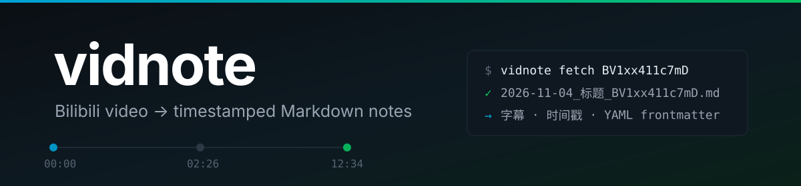
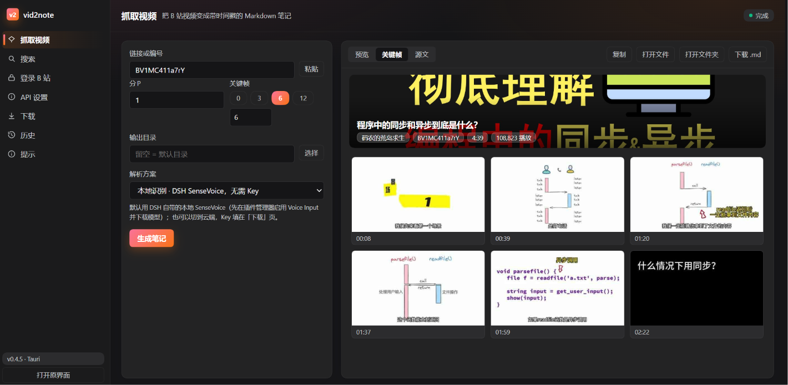
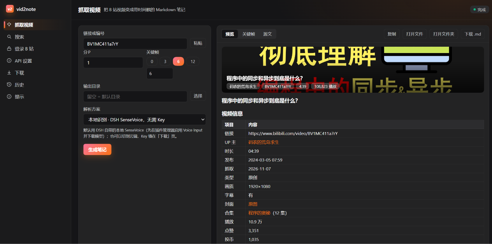
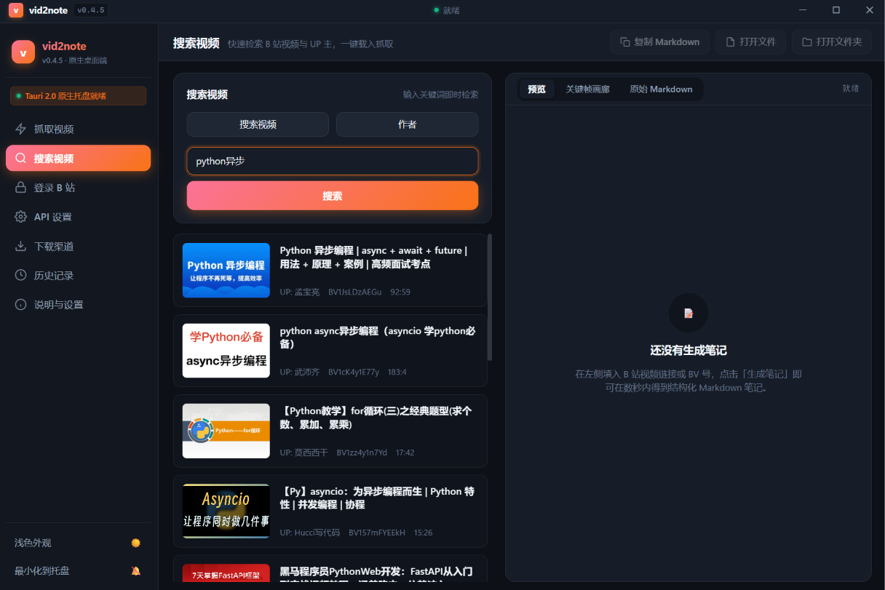
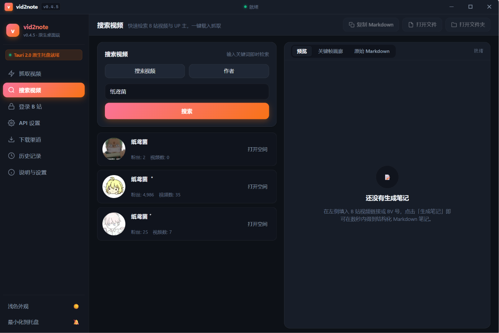
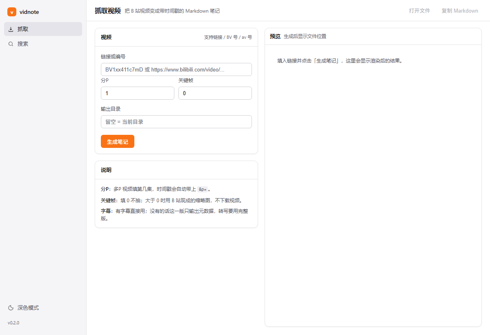
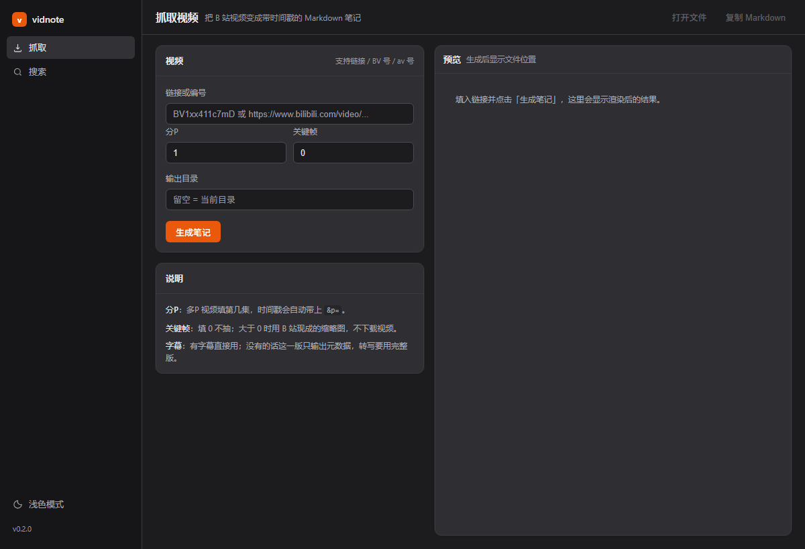

<p align="center">
  
</p>

<h1 align="center">vid2note</h1>

<p align="center">
  <b>把 B 站视频变成一篇带时间戳的 Markdown 笔记。</b><br>
  <sub>标题 · UP 主 · 分P · 简介 · 字幕，一个文件装完，点时间戳直接跳到视频对应位置。</sub><br>
  <sub>只做 B 站——分P、UP 主语义、中文字幕格式，通用转写工具不会替你处理这些。</sub>
</p>

<p align="center">
  <a href="https://github.com/paper-k1te/vid2note/actions/workflows/ci.yml"></a>
  
  
  
  
</p>

<p align="center">
  <a href="#-它能做什么">它能做什么</a> ·
  <a href="#-快速开始">快速开始</a> ·
  <a href="#-没有字幕怎么办">本地转写</a> ·
  <a href="#-给-agent-用">给 agent 用</a> ·
  <a href="#-常见问题">FAQ</a> ·
  <a href="#english">English</a>
</p>

---

## 📷 项目预览

| 抓取与关键帧 | 预览与资料 |
| --- | --- |
|  |  |
| 抓取视频，右侧直接在「预览 / 关键帧 / 源文」间切换 | 元数据、分P、时间戳和原始 Markdown 都能核对 |

| 搜索视频 | 搜索 UP 主 |
| --- | --- |
|  |  |
| 关键词搜视频，一键带回抓取页 | 按作者搜，显示粉丝数、投稿数和空间入口 |

```console
$ vid2note fetch BV1xx411c7mD --whisper
✓ 已生成 2026-11-04_标题_BV1xx411c7mD.md  （本地转写，412 条）
```

打开就是这个样子：

```markdown
---
title: 一个测试视频
platform: bilibili
bvid: BV1xx411c7mD
url: https://www.bilibili.com/video/BV1xx411c7mD
owner: 某UP
duration: 1:02:03
published: 2024-05-01
fetched: 2026-11-04
language: zh
subtitle: available
tags:
- bilibili
- vidnote
---

## 字幕

**00:00** 大家好，今天想聊一个很多人问过的问题。

**12:34** 这里是重点，我把它拆成三步。
```

## ✨ 它能做什么

- **一条命令归档**：链接、BV 号、av 号、b23.tv 短链都支持识别，自动抓标题、UP 主、分区、时长、发布时间、简介、标签，以及播放 / 点赞 / 投币 / 收藏 / 弹幕 / 评论数据。
- **分P 不迷路**：多P 视频会记录当前在第几集，时间戳链接自动添加 `&p=`。
- **先搜再抓**：`vid2note search "关键词"` 直接列出候选视频，挑中 BV 号再归档。
- **字幕优先，云端转写兜底**：视频有字幕就直接用；没有就把音频交给 Gemini 或 OpenAI 兼容的 Whisper 接口，拿回带时间戳的文本再拼成笔记。
- **自动关键帧**：默认取 6 张，用 B 站现成的缩略图切出画面，按时间插在对应字幕后面；`--frames 0` 关闭，加 `--scene` 则按画面变化重新选帧。
- **时间戳可点**：`[12:34](…?t=754)`，在 Obsidian、Logseq、浏览器里都能跳转。
- **YAML frontmatter**：字段固定，能被 Dataview 之类的工具直接查询、筛选、聚合。

## 🚀 快速开始

```bash
pip install vid2note
```

```bash
# 先搜，看看有哪些视频
vid2note search "Python 异步编程"

# 链接、BV 号、av 号都行
vid2note fetch "https://www.bilibili.com/video/BV1xx411c7mD"

# 第 2 个分P
vid2note fetch "https://www.bilibili.com/video/BV1xx411c7mD/?p=2"

# 只打印，不写文件
vid2note fetch BV1xx411c7mD --stdout

# 存到笔记库，并标记来源
vid2note fetch BV1xx411c7mD --dir ~/Notes/videos --source my-blog
```

没装包也可以直接跑：

```bash
uvx vid2note fetch BV1xx411c7mD
```

### 图形界面

```bash
vid2note gui
```

会起一个只监听 `127.0.0.1` 的本地服务，用浏览器打开界面：左侧是抓取 / 搜索 / 登录 / API / 下载 / 历史 / 提示七个入口，右侧在「预览 / 关键帧画廊 / 源文」之间切换，支持复制 Markdown、打开文件、深浅色切换。搜索页可以在「视频 / 作者」之间切换，作者结果会显示粉丝数和签名，点一下直接打开 B 站空间。

<p align="center">
  
  
</p>

界面沿用 cc-switch 的设计语言（浅底灰阶 + 单一橙色强调色 + 13px 字号）。想用独立窗口而不是浏览器标签页，加 `--app`（Edge 未运行时更可靠）。

### 桌面应用（Tauri 2.0 原生 Rust 桌面端 + 系统托盘）

v0.4.6 起，桌面端全面升级为 **Tauri 2.0 原生 Rust 核心与系统托盘驻留**：

```powershell
powershell -File scripts/build_tauri.ps1
# 产物：dist-app/vid2note.exe （纯 Rust 编译原生桌面端，约 8.8 MB）
```

| | Tauri 2.0 桌面版 |
| --- | --- |
| 架构 | Rust 原生桌面外壳 + 系统托盘核心 (`src-tauri`) |
| 托盘能力 | 支持最小化到托盘、托盘右键菜单、单击平滑显隐、快速抓取剪贴板 |
| 界面设计 | 全新高颜值现代流体工作台（深浅色无缝切换、交互式时间戳、关键帧画廊） |
| 抓取 / 搜索 / 笔记 / 缩略帧 | ✅ |
| 转写 | ✅ 云端转写（Gemini / Whisper API，默认）；Vosk / whisper 可选本地 |
| 核心体积 | 约 8.8 MB（轻巧极速，秒级冷启动） |

转写引擎可选：

| 引擎 | 首次下载 | 说明 |
| --- | --- | --- |
| 云端 `cloud` | 无 | 默认；需要 Gemini 或 OpenAI 兼容接口的 API Key |
| Gemini `gemini` | 无 | 音频直传 Gemini，时间戳准 |
| Whisper API `whisper-api` | 无 | 任何兼容 `/audio/transcriptions` 的服务 |
| Vosk `vosk-cn` | 42 MB | 可选，装 `[vosk]` 后离线用 |
| whisper `tiny` | 75 MB | 本机，最快，质量一般 |
| whisper `base` | 145 MB | 本机，平衡 |
| whisper `small` | 485 MB | 本机，中文最好 |

`vid2note.exe` 采用 **Tauri 2.0 原生桌面框架**：
- **原生系统托盘**：常驻 Windows 托盘区，支持最小化到托盘、一键从剪贴板抓取、定位输出目录。
- **窗口关闭拦截**：点击右上角关闭按钮默认优雅隐藏至托盘，不中断后台抓取与长转写。
- **超轻体积与内存优化**：告别以往百兆外壳，二进制仅 ~8.8 MB，内存占用大幅减少。
- **现代化视觉体验**：支持沉浸式深暗色/轻盈浅色主题、四阶段进度动效、关键帧画廊与交互式时间戳芯片。

### Windows 免安装 exe

不想装 Python 的话，可以自己构建单文件可执行程序（约 15 MB）：

```powershell
powershell -File scripts/build_exe.ps1
# 产物：dist-exe\vidnote-ui.exe（双击开界面，无命令行窗口）
#       dist-exe\vid2note.exe（命令行版）
```

这个 exe 是**核心版**：抓取、搜索、笔记生成、缩略帧（`--frames`）都在里面。不含两项重型能力：

| 能力 | 为什么不在 exe 里 |
| --- | --- |
| 本地转写（`--whisper`） | `faster-whisper` + `ctranslate2` + `onnxruntime` 会让体积涨到 300 MB 以上，模型仍需首次下载 |
| 按画面变化选帧（`--scene`） | 需要 PyAV 和 yt-dlp，且要下载整段视频 |

需要它们时用 pip 安装对应依赖：`pip install 'vidnote[whisper]'` 或 `pip install 'vidnote[scene]'`。

> exe 运行时需要系统临时目录可写（PyInstaller 会先解压到 `%TEMP%`）。如果报 `Could not create temporary directory`，检查 `TEMP` 环境变量是否指向一个可写目录。

### 退出码

|  码  | 含义                                 |
| :---: | ------------------------------------ |
| `0` | 成功                                 |
| `1` | 输入无法解析、接口报错、网络失败     |
| `2` | 缺少可选依赖（如转写所需的 whisper） |
| `3` | 目标文件已存在，且没有加 `--force` |

脚本里判断退出码即可，不需要解析输出。

## 🔊 没有字幕怎么办

B 站对字幕接口做了登录限制，**未登录时大多数视频拿不到字幕**。所以默认走**云端转写**：把音频交给 Gemini 或任意 OpenAI 兼容的 Whisper 接口，拿回带时间戳的逐句文本，再生成笔记。

桌面端第一次用需要填一个 API Key（DSH 插件默认走本地识别，不需要 Key）：

```bash
export GEMINI_API_KEY=...        # Gemini（优先识别 AIza 开头的 Key）
export OPENAI_API_KEY=...        # 或 OpenAI 兼容转写服务
export VID2NOTE_ASR_BASE=...     # Whisper 兼容接口的 base URL，可省略
```

命令行：

```bash
vid2note fetch BV1xx411c7mD --cloud
vid2note fetch BV1xx411c7mD --cloud --asr-provider whisper --asr-key sk-...
```

隐私说明：云端模式下**音频会上传到对应服务商**；Key 只从参数/环境变量读取，不写进笔记、不落盘。费用按各家音频计费（Gemini 2.5 Flash 很便宜，1 小时视频约 10 万音频 token）。

想完全离线可以装本地引擎：

```bash
pip install 'vid2note[vosk]'     # 42 MB 中文模型，首次使用下载
pip install 'vid2note[whisper]'  # faster-whisper
vid2note fetch BV1xx411c7mD --vosk
```

桌面端默认不再内置 Vosk 模型，安装包因此小了约 65 MB；本地 Vosk 需要自己装依赖，或者直接用云端。whisper 的推理引擎仍可在界面里点一次「安装 whisper 依赖」（约 66 MB）。

whisper 的模型大小：

| 模型              |   大小 | 速度 | 建议                           |
| ----------------- | -----: | ---- | ------------------------------ |
| `tiny`          |  75 MB | 最快 | 只用来验证流程，中文质量差     |
| `base`          | 145 MB | 快   | 英文内容                       |
| `small`（默认） | 485 MB | 中等 | 中文内容，速度与准确率的平衡点 |
| `medium`        | 1.5 GB | 慢   | 对准确率要求高                 |

```bash
vid2note fetch BV1xx411c7mD --whisper --model medium
```

转写结果按 `视频 + 分P + 模型` 缓存在本地（Windows 在 `%LOCALAPPDATA%\vidnote`，其他系统在 `~/.cache/vidnote`），同一个视频第二次跑秒出。加 `--no-cache` 可跳过。

## 🔍 搜索视频

```bash
vid2note search "Rust 所有权" --limit 5
```

输出一张表：BV 号、标题、UP 主、时长、播放量。加 `--json` 可以直接喂给脚本：

```bash
vid2note search "Rust 所有权" --json | jq -r '.[].bvid'
```

搜索走的是 B 站公开的 `search/all/v2` 接口，**不需要登录**。如果返回 `-352`，说明触发了风控，等一会儿或降低频率再试。

## 🖼 关键帧

```bash
vid2note fetch BV1xx411c7mD           # 默认 6 张
vid2note fetch BV1xx411c7mD --frames 0  # 关闭关键帧
```

关键帧导出到笔记旁边的 `<笔记名>_frames/` 目录。有字幕时，每张图会插在它前面最近的那句字幕后面——读到哪里，画面就在哪里；没有字幕时才单独成「关键帧」一节。

默认走 B 站现成的**缩略图雪碧图**（10×10 的拼图，服务端已按时间点切好）：只下载一张几百 KB 的图片再裁开，**不下载视频、不解码、不需要系统 ffmpeg**。拿不到缩略图时会跳过并提示，不影响笔记生成。

需要「按画面变化选帧」时加 `--scene`，这条路径会下载视频并逐帧比较，依赖更重：

```bash
pip install 'vidnote[scene]'
vid2note fetch BV1xx411c7mD --frames 6 --scene
```

它按每秒 2 帧采样成 64×36 的灰度缩略图，比较相邻帧差异，抓 PPT 翻页、代码切换这类真正的信息点，全程本地计算，不调用任何 AI 服务。

网络拿不到视频流时（B 站的视频 CDN 在部分网络下不可达），可以先自己下载，再用本地文件：

```bash
vid2note fetch BV1xx411c7mD --frames 6 --video ~/Downloads/lecture.mp4
```

## 🤖 给 agent 用

装上 MCP 依赖后，把 vidnote 注册成一个 MCP server：

```bash
pip install 'vidnote[mcp]'
vid2note serve
```

Claude Code / Codex / Cursor 的配置：

```json
{
  "mcpServers": {
    "vidnote": {
      "command": "vidnote",
      "args": ["serve"]
    }
  }
}
```

agent 会多出一个工具 `fetch_note`：

| 参数             | 说明                                   |
| ---------------- | -------------------------------------- |
| `target`       | 链接、BV 号或 av 号                    |
| `page`         | 分P 序号，默认 1                       |
| `include_desc` | 是否包含简介，默认 `true`            |
| `transcribe`   | 没有字幕时是否本地转写，默认 `false` |

### DeepSeek Harness（DSH）插件

仓库里的 [`dsh-plugin/`](dsh-plugin/) 把 vidnote 包成 DSH 插件，模型直接调用工具，不用自己拼命令行：

| 工具 | 作用 |
| --- | --- |
| `vidnote_note` | 给链接 / BV 号 / av 号，返回整篇带时间戳的 Markdown |
| `vidnote_search` | 按关键词搜 B 站视频，返回 BV 号、标题、UP 主、时长、播放量（JSON） |
| `vidnote_user` | 按关键词搜 UP 主，返回 UID、昵称、粉丝、投稿数、签名、空间链接（JSON） |

界面也是原生的：会话视图栏里「对话 / 轨迹」旁边多一个「B站笔记」，布局照着原窗口（左侧导航 + 表单 + 渲染好的 Markdown 预览）；抓取进度、关键帧、输出目录、Cookie、whisper 依赖都通过代理复用 vidnote 自己的接口，功能和原窗口一致，状态切标签页不会丢。需要原窗口时点「打开原界面」，会起 vidnote 自己的独立应用窗口。

插件默认的转写方式是 **DSH 自带的本地 SenseVoice**（voice-input bundle，CPU，无需任何 Key，音频不出本机）：先在插件管理器启用 Voice Input 并下载约 239 MB 模型，然后在「解析方案」里保持「本地识别 · DSH SenseVoice」。也可以切回云端 Gemini / Whisper API。关键帧数量除 0/3/6/12 预设外，可以直接填 0–30 的任意数量。

```bash
dsh plugin --profile desktop add ./dsh-plugin
```

插件调用本机的 vidnote 命令行，按「配置里的 `cliPath` → `VIDNOTE_CLI` → 仓库构建产物 → 常见安装位置 → PATH」的顺序查找。安装后在「插件」页显示为 **vid2note — B 站视频转 Markdown 笔记**。完整参数和配置见 [`dsh-plugin/README.md`](dsh-plugin/README.md)。

## 🧭 设计原则

三条承诺，都能在代码里验证：**只读公开接口**，不模拟登录、不批量抓取；**不编造内容**，没有字幕就说没有，不会用模型编一段假的；**不覆盖你的文件**，笔记里可能有你手写的东西，除非你显式 `--force`。

## ❓ 常见问题

<details>
<summary><b>会被 B 站封号吗？</b></summary>

这个工具只读取公开的视频信息和匿名可访问的接口，不登录、不发布、不改动你的账号。但**请控制请求频率**，不要拿它做批量爬取。用 shell 循环处理很多视频时，加上 `--delay 3`，让两次请求之间等 3 秒。

</details>

<details>
<summary><b>需要 OpenAI 或其他 API Key 吗？</b></summary>

不需要。转写在本地用 `faster-whisper` 跑，不联网、不调用任何云端模型。

</details>

<details>
<summary><b>转写太慢怎么办？</b></summary>

换小模型（`--model base` 或 `tiny`）。长视频（1 小时以上）用 `small` 在普通笔记本上大约需要 10–20 分钟。

</details>

<details>
<summary><b>为什么笔记里没有字幕？</b></summary>

说明这个视频没有可用字幕，而你也没加 `--whisper`。工具会明确写出"没有可用字幕"。

</details>

<details>
<summary><b>支持抖音、小红书、YouTube 吗？</b></summary>

暂不支持，见路线图，后续会更新

</details>

<details>
<summary><b>Windows 上有什么坑？</b></summary>

`faster-whisper` 依赖的 PyAV 在 14 之后改了接口，和部分版本不兼容。项目的 `[whisper]` 依赖已经锁定了可用版本，正常 `pip install` 不会踩到。

</details>

## 🗺 路线图

- [X] B 站单P/多P 抓取、字幕、时间戳
- [X] 无字幕视频的本地转写
- [X] 关键词搜索
- [X] 画面变化检测的关键帧
- [X] CLI + MCP
- [ ] 按简介里的时间点自动生成章节
- [ ] 批量：一个收藏夹 / 一个 UP 主的所有视频
- [ ] 抖音、小红书
- [ ] 导出为 SRT / VTT

## 🛠 开发

```bash
git clone https://github.com/paper-k1te/vid2note.git
cd vidnote
pip install -e '.[dev]'

pytest          # 86 个测试
ruff check .    # 代码检查
```

CI 覆盖 Ubuntu 与 Windows，Python 3.10 / 3.12 / 3.13。

## 📄 许可证

[MIT](LICENSE)。可自由使用、修改、商用，保留版权声明即可。

---

<a id="english"></a>

## English

**vid2note** turns a Bilibili video into a timestamped Markdown note: title, uploader,
multi-part awareness, description, and a transcript — all in one portable file with
clickable timestamps.

```bash
vid2note fetch "https://www.bilibili.com/video/BV1xx411c7mD" --whisper
```

- Uses Bilibili's public web API; no login, no scraping workarounds.
- Search first (`vid2note search "keyword"`), then archive the BV ids you care about.
- If a video has no captions (most don't without a session), transcribe locally with
  `faster-whisper` — audio never leaves your machine.
- `--frames N` crops N thumbnails from Bilibili's storyboard sprites (no video download,
  no ffmpeg). Add `--scene` to pick frames by actual scene changes instead.
- Output is plain Markdown with YAML frontmatter, ready for Obsidian or any tool.
- Ships a CLI, an MCP server (`vid2note serve`), and a 15 MB standalone Windows exe.

MIT licensed.
